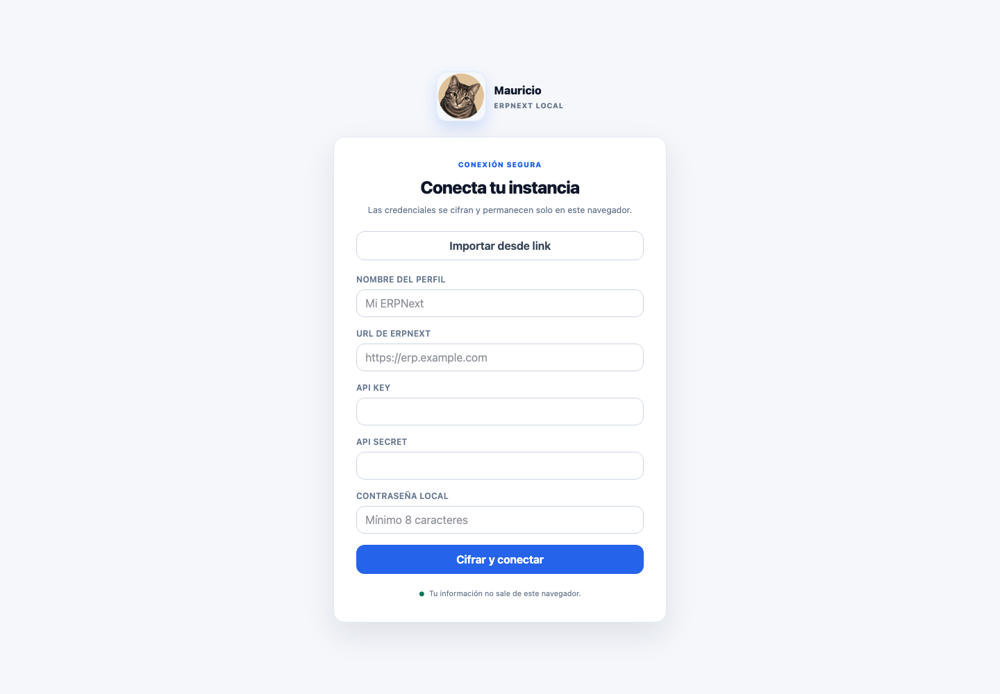
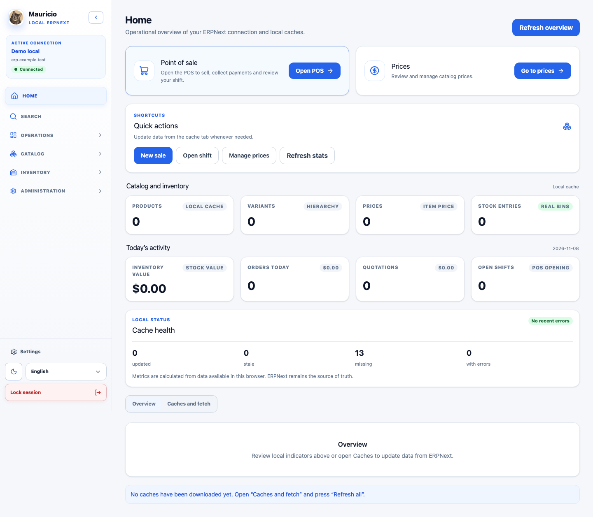

<p align="center">
  
</p>

# Mauricio_ERPNext

A local-first, instance-agnostic browser client for store operations in ERPNext. The React/Vite SPA connects directly to each user's ERPNext site through its REST API; this project has no application backend.

## Screenshots

The home screen uses an isolated demo profile and empty sample data; the screenshots contain no real ERPNext records or credentials.

| Secure connection setup | Operational home |
| --- | --- |
|  |  |

## Scope

The SPA talks to ERPNext directly over REST; there is no backend of its own and no data is stored on any server belonging to this project. Connections are configured in the browser as profiles. Credentials are encrypted with Web Crypto, and the temporary local session can be restored across tabs and page refreshes for up to eight hours after unlocking. Locking the session in one tab locks it in the others.

Features include:

- Product catalog with explicit search, product editing, and local caching.
- Variant hierarchy based on `variant_of`, plus UOM conversions and product creation/editing.
- Buying, selling, and supplier prices; supplier directory; stock lookup and reconciliation.
- Point of sale, opening and closing shifts, daily sales, sales orders, and quotations.
- Cached DocType explorer, configurable home page, local cache tools, and Spanish/English interface.

## Cache and ERPNext

Catalogs are stored in IndexedDB per connection profile and are not downloaded again when navigating between views. The hierarchy renders from that cache; use the refresh buttons when you need to sync external changes.

UOM data is read from `UOM Conversion Detail` in a single paginated load. If the user lacks permission on that child DocType, the app falls back to the `uoms` rows included in each `Item` document. This avoids requiring extra permissions just to view presentations.

The per-product editor fetches the `Item` document once to load its UOMs and conversions. The name catalog of the `UOM` DocType is stored in a separate IndexedDB store per profile, reused for 24 hours, and synced in pages of 500 records when it expires. If the sync fails but a local copy exists, that copy is kept so the editor is not blocked. React Query keys also include the profile so data from different ERPNext connections never mixes.

Local caches are kept in IndexedDB per profile. Successful edits may update an entity locally, but they keep the local-changes marker until a full catalog refresh runs.

The variant hierarchy virtualizes its roots when a search yields more than 200 nodes; small catalogs keep normal rendering for simple, accessible interaction.

## Requirements and development

Use Node.js compatible with the project's Vite toolchain and npm.

```bash
npm install
npm run dev
```

`npm run dev` starts Vite locally. `npm run build` performs the TypeScript check and creates the production bundle. `npm run lint` runs ESLint.

The app has no backend. Each user configures their instance URL, API Key, and API Secret in the browser. Credentials are encrypted with Web Crypto before being stored locally and are never included in the bundle.

## Feature flags

Flags are currently read from `VITE_FF_*` variables at build time. Resolution is isolated in `src/lib/feature-flags.ts`, so the provider can later move to Firebase Remote Config, LaunchDarkly, or another service without coupling components to it. See `.env.example` for the available names.

## Verification

```bash
npm run lint
npm run i18n:lint && npm run i18n:status
npm run build
npm run check:bundle
npm test
npm run test:e2e
```

The `.github/workflows/ci.yml` workflow runs these same steps, but only when triggered manually from the GitHub Actions tab; it does not run on every push or pull request.

`npm run test:e2e` uses mocked data and checks responsive navigation on mobile, tablet, and desktop. To test the real integration, `npm run test:e2e:erpnext` starts a disposable local ERPNext in Docker, wipes its volumes, creates working fixtures over REST, and runs the suite on mobile, tablet, and desktop. It requires Docker, Node, and a local Chrome compatible with Playwright.

## Real ERPNext E2E

```bash
cp .env.erpnext.example .env.erpnext.local # optional: defaults are local
npm run erpnext:up
npm run erpnext:health
npm run test:e2e:erpnext
```

`test:e2e:erpnext` automatically resets the local environment before seeding data. API credentials are generated after seeding and stored only in the git-ignored `.env.erpnext.local` file. The stack uses the official `frappe/erpnext` image and is available at `http://127.0.0.1:8080`. To destroy it manually:

```bash
npm run erpnext:reset
```

The reset removes only the volumes of the `mauricio-erpnext-e2e` Docker project. Never run these scripts against a remote or production instance.

The ERPNext instance must allow CORS from the domain where the SPA is deployed. Production accepts HTTPS URLs; HTTP is limited to `localhost` for development.

## Deployment

`npm run build` produces static files in `dist/`. Serve that folder from any static host with HTTPS and configure a route fallback to `index.html`, because the SPA uses browser routes (`/items`, `/pos`, etc.). `VITE_FF_*` feature flags are fixed at build time; there are no runtime environment variables.

## Main routes

- `/`: operational home.
- `/pos`, `/pos/turnos`, `/pos/ventas`, `/pos/cotizaciones`: point of sale, shifts, sales, and quotations.
- `/items`, `/variants`: product catalog, variant hierarchy, and UOM management.
- `/prices`, `/suppliers`: product prices and supplier catalog.
- `/stock`, `/stock/reconciliation`: stock lookup and reconciliation.
- `/doctypes`, `/settings`: DocType explorer, preferences, local caches, and connection settings.

Never include API keys, API secrets, local passwords, or real ERPNext responses in commits, screenshots, or issues.

## License

This project is licensed under [CC BY-NC-SA 4.0](./LICENSE). You may use, study, and modify it for non-commercial purposes with attribution to the author. Any modified version you share must be released under the same license. Commercial use requires explicit permission from the author.
